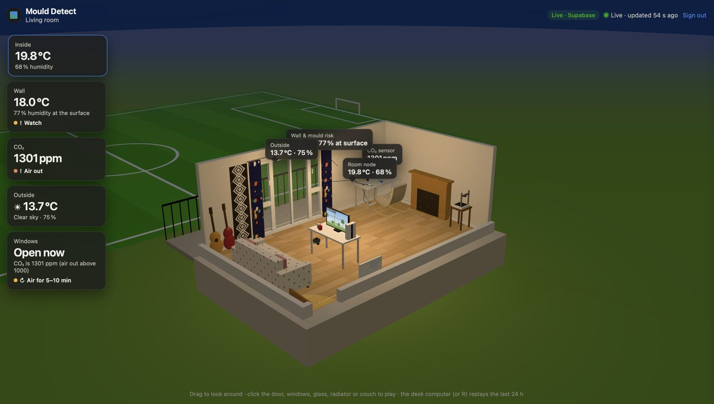
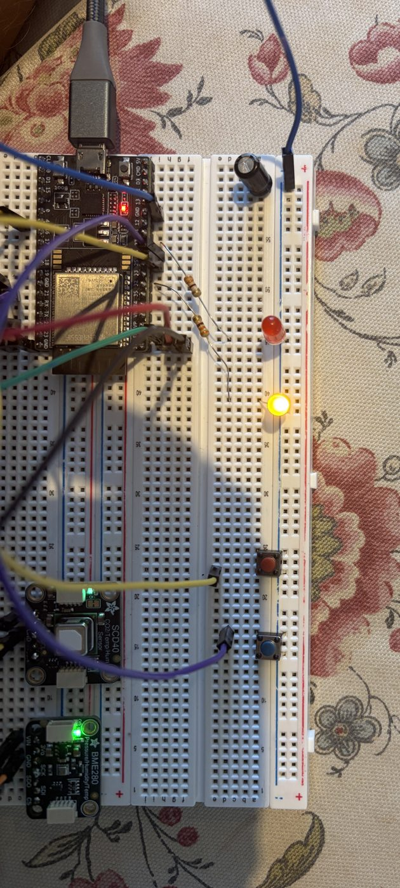
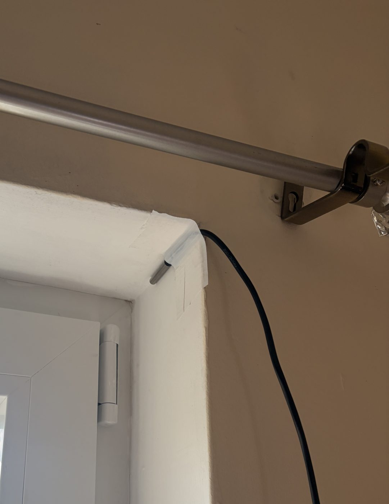
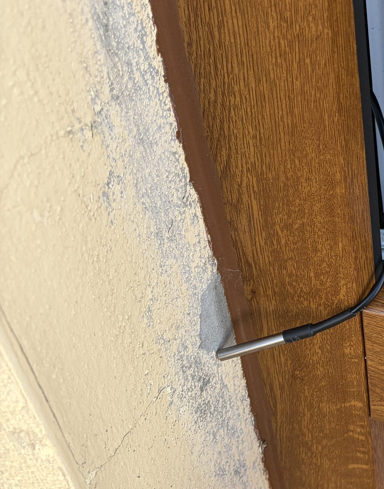
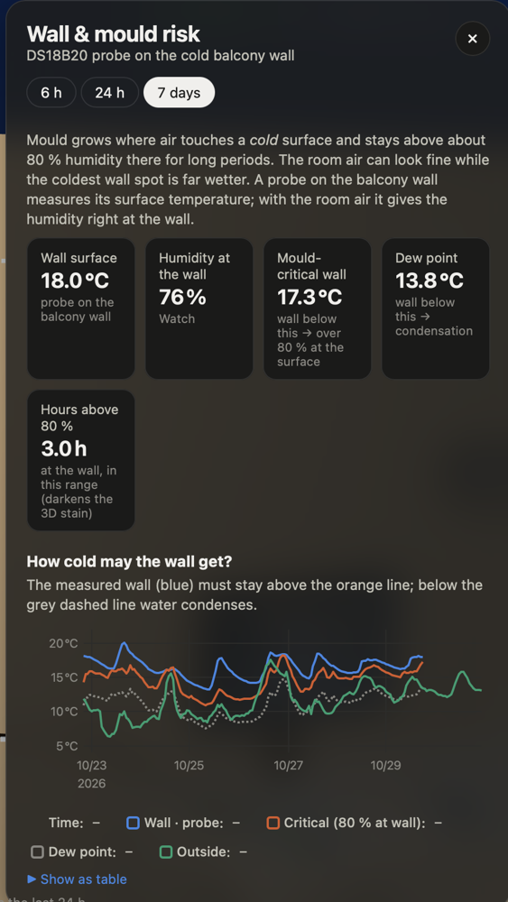
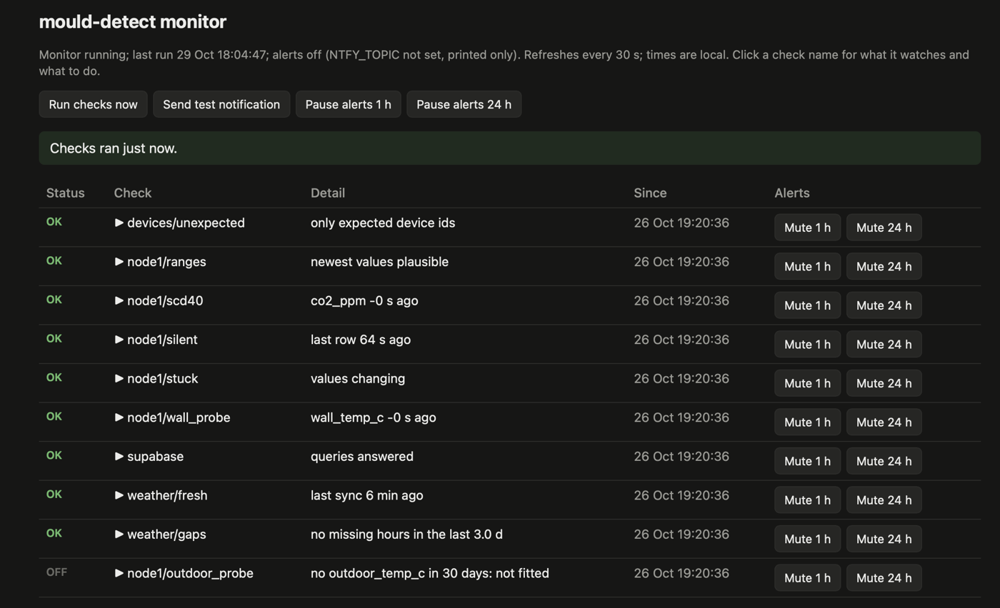

# mould-detect

A home sensor network that estimates mould risk and says when to ventilate.


<sub>Live dashboard on real data, 29 Oct 2026. The public demo shows the same page with synthetic data.</sub>

Mould grows on cold walls in humid rooms, and you usually notice it only once it is visible. This project measures
the conditions that cause it and shows them while there is still time to ventilate. An ESP32 room node measures
indoor temperature, humidity and pressure, CO₂ and the temperature of the coldest outside wall, plus window/door
state (buttons for now); outdoor conditions come from Open-Meteo (an outdoor probe is mounted, not yet reporting). It sends a reading to Supabase (hosted Postgres) every minute.
A 3D web dashboard turns the readings into building-physics quantities (dew point, humidity at the wall surface) and
ventilation advice.

**Status (work in progress):** one room node has logged every minute since 6 Oct 2026. Hourly weather comes from
Open-Meteo, and the dashboard shows the room live, or runs on synthetic data in demo mode. A pipeline monitor and
a self-hosted API with a load test exist alongside it. **Not built yet:** the mould-risk model and the
machine-learning forecast. Both need a winter of data, so they come from December onwards. See
[Status and limitations](#status-and-limitations) and [docs/roadmap.md](docs/roadmap.md).

**Try it without hardware:** `cd dashboard && python3 serve.py --no-weather`, then open http://localhost:8000. The
dashboard runs on synthetic demo data (Python 3 and a browser, nothing to install).

## How it works

```
room node (BME280, SCD-40 CO₂, DS18B20 wall + outdoor probes, window/door buttons)
        │ Wi-Fi, HTTPS POST every minute
        ▼
Supabase Postgres (readings, weather_hourly) ◄── jobs/fetch_weather.py (Open-Meteo, hourly)
        │                                    ◄── services/monitor (checks, phone alerts via ntfy)
        ▼
dashboard/ (static site): 3D room, charts, dew point, wall-surface humidity, ventilation advice

planned: window contacts · mould-risk index (VTT model) · forecast of wall-surface humidity (analysis/, Python)
```

Mould grows where the **air next to a cold surface** stays humid, not where the room air is humid. A room at 20 °C
and 60 % RH has a dew point of 12 °C; a wall at 15 °C in that room sits at about 82 % surface relative humidity.
The wall temperature probe is what lets the system see this. Details: [docs/architecture.md](docs/architecture.md).

## Hardware

| | | |
|---|---|---|
|  |  |  |
| Room node: ESP32, BME280 (T, RH, pressure), SCD-40 (CO₂), window/door buttons with LEDs | Wall probe in the window reveal, the coldest spot of the outside wall | Outdoor probe on the window frame (mounted, not yet reporting) |

Wiring and parts: [firmware/README.md](firmware/README.md), [docs/hardware.md](docs/hardware.md). Photos are prepared with
`scripts/prepare_image.py` (cropped, location data removed).

## Dashboard and monitor

| Wall & mould-risk panel | Pipeline monitor |
|---|---|
|  |  |
| The wall must stay above the orange line (80 % humidity at the surface); below the dashed dew-point line water condenses. 7 days of real data. | Checks every 60 s: node silent, value ranges, stuck values, probes, unknown devices, weather gaps. The outdoor probe shows OFF because it is not reporting yet. |

## Repository layout

| Folder | Contents |
|---|---|
| [`firmware/`](firmware/) | ESP-IDF projects, one per node type (`room_node/` now; `window_node/`, `gateway/` later) |
| [`supabase/`](supabase/) | Database schema as ordered SQL migrations |
| [`jobs/`](jobs/) | Scheduled server-side jobs: Open-Meteo weather fetch (`fetch_weather.py`) |
| [`dashboard/`](dashboard/) | Static website: live 3D room, charts, ventilation advice; demo mode with synthetic data |
| [`services/`](services/) | Long-running services: pipeline monitor with alerts and a status page ([`monitor/`](services/monitor/)), own API with live traffic page ([`api/`](services/api/)) |
| [`analysis/`](analysis/) | Planned Python package (physics, mould-risk model, forecasting); only the layout so far |
| [`docs/`](docs/) | Architecture, hardware list, roadmap |
| [`loadtest/`](loadtest/) | Locust ramp load test for the API ([results](docs/loadtest-2026-10-26.md)) |
| [`scripts/`](scripts/) | Repository checks (`check_public.sh`), `prepare_image.py` (photos and screenshots without location data) |

Recorded house data (`data/`) and trained models (`models/`) are never committed: CO2 and window state reveal when
people are home. Examples in this repo use synthetic data.

## Getting started

- Firmware: [firmware/README.md](firmware/README.md) (ESP-IDF v6.1, credentials from the `*secrets.example.h` files)
- Database: [supabase/README.md](supabase/README.md)
- Dashboard: [dashboard/README.md](dashboard/README.md) (`cd dashboard && python3 serve.py`; it also keeps the
  weather table complete while it runs)
- Weather job: `cp .env.example .env`, fill it in, then `python3 jobs/fetch_weather.py --sync` (fills every missing
  hour, then reports the coverage; Python 3, standard library only; tests: `python3 -m unittest discover -s jobs`).
  Around the clock: `.github/workflows/weather.yml` runs it hourly once the four `.env` settings are added as
  repository secrets (Settings → Secrets and variables → Actions)
- API: [services/api/README.md](services/api/README.md) (`python3 services/api/api.py`, traffic page on
  http://127.0.0.1:8200/traffic; the dashboard can read from it)
- Monitor: [services/monitor/README.md](services/monitor/README.md) (`python3 services/monitor/monitor.py`, status
  page and controls on http://127.0.0.1:8100, phone alerts via ntfy)

## Tests

No installs needed except where noted:

```bash
firmware/room_node/test_host/run.sh           # C drivers (SCD-40, DS18B20, buttons) on the host, plain cc
python3 -m unittest discover -s jobs          # weather sync
python3 -m unittest discover -s services/monitor
python3 -m unittest discover -s services/api
cd dashboard && npm test                      # physics, sun position, demo data, room layout, charts (Node only)
.venv/bin/python -m unittest discover -s loadtest   # needs Locust in .venv (see loadtest/README.md)
scripts/check_public.sh                       # checks that no secret, personal data or data file gets published
```

Not covered by tests: the Wi-Fi/HTTPS code in `main.c` (checked on the hardware only) and the three.js scene
rendering (the room layout data is tested, the drawing is not).

## Status and limitations

- **One room, one winter so far.** The data started on 6 Oct 2026. There is no mould-risk model or forecast yet;
  the dashboard's mould stain is a visual scale (hours above 80 % surface humidity), not a growth model.
- **Humidity sensors disagree:** the BME280 and the SCD-40 give dew points about 2 °C apart. A salt-jar calibration
  test (saturated salt water holds the air at about 75 % RH) is pending.
- **Window state comes from buttons** pressed by hand until the wired window contacts are installed.
- **Weather sync** runs hourly on GitHub Actions (`.github/workflows/weather.yml`, settings as repository secrets)
  and while `dashboard/serve.py` runs; GitHub may start scheduled runs late, and the sync fills any gap.
- **The services (monitor, API) are tested but not yet run on the real data.**
- Recorded data is private: the public demo runs on synthetic data only.

## Future improvements

In rough order; details in [docs/roadmap.md](docs/roadmap.md).

1. **Mould-risk index** (the VTT model from Finnish building research): computed hourly from the wall-surface
   conditions and drawn on the 3D wall.
2. **Forecast of wall-surface humidity 6–12 h ahead** from the weather forecast. It will be evaluated honestly:
   time-based train/test splits, compared against persistence and physics baselines, with the error reported per
   forecast horizon.
3. **Ventilation effectiveness:** air-change rate from the CO₂ decay after each opening ("10 min of airing removed
   X g of water"), then advice on the shortest airing that does the job.
4. **Window contacts** wired to the room node, and an advice LED that lights up when airing is advised.
5. **Always-on backend:** weather sync and services on a Raspberry Pi (systemd units, Cloudflare Tunnel, backups).
6. **Firmware:** SNTP timestamps, an offline backlog when Wi-Fi drops, a heartbeat.
7. **Dashboard:** a data-quality panel (uptime, gaps, sensor disagreement), a psychrometric chart, a diary of
   events the sensors cannot see (laundry, guests, away).
8. **Write-up after the winter:** what the data showed, with the evaluation numbers.

## Background

The firmware grew out of a staged ESP-IDF learning project (BME280 over I2C → Wi-Fi with reconnect → HTTPS to
Supabase).

## Licence

MIT, see [LICENSE](LICENSE).
